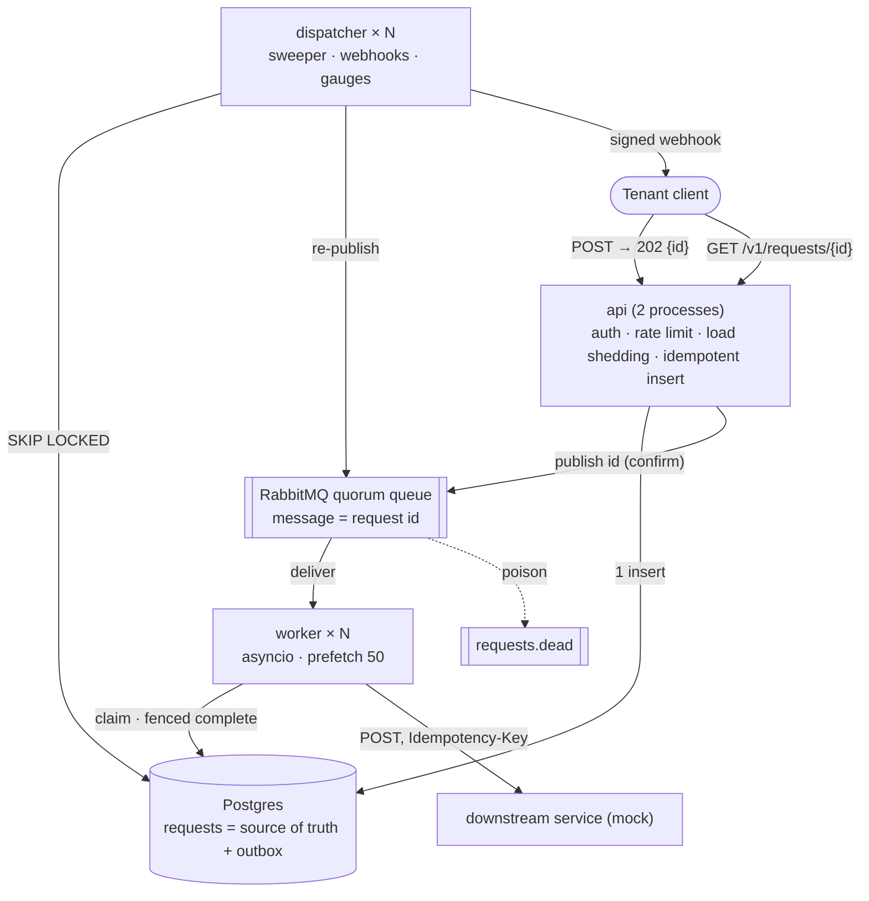
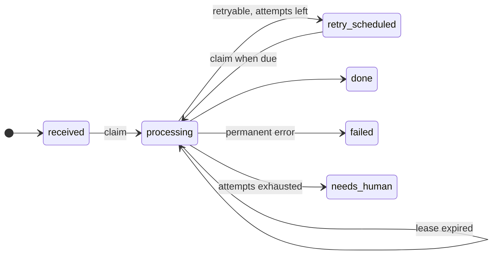

# Request pipeline for a public API

Follow-up to the Chekin system design interview. The task was a public API that receives requests from thousands of tenants (about **1M per hour**). The interview diagram covered intake: auth → validate → persist → queue → workers, plus observability. The open question was **what happens after a worker takes a request off the queue**, and how that part scales and survives failures.

This repository is a runnable prototype of that part. It also contains the decisions behind it, each with the alternatives considered.

## Guarantees and the evidence for each

| Guarantee | How | Proved by |
|---|---|---|
| Every accepted request reaches a final state | Postgres is the source of truth. A sweeper re-publishes lost messages, due retries and expired leases | `test_lost_publish_is_recovered_by_the_sweeper`, `test_broker_down_at_intake_is_recovered_without_client_retry`, `test_worker_killed_mid_processing_still_finishes` |
| No duplicate effects under at-least-once delivery | Conditional claim, `attempt` as a fencing token, request id as the downstream `Idempotency-Key` | `test_stale_attempt_cannot_complete`, `test_duplicate_delivery_processes_once`, `test_client_replay_creates_one_request_and_one_effect` |
| Failures are classified, retried with backoff, or handed to a human | Retryable vs. permanent errors; full-jitter backoff; `max_attempts`, then `needs_human` | `test_flaky_downstream_is_absorbed_by_retries`, `test_downstream_down_ends_in_needs_human_after_max_attempts` |
| One tenant cannot hurt the others | Per-tenant token bucket; per-tenant webhook concurrency and claim cap | `test_noisy_tenant_is_limited_without_affecting_others`, `test_webhook_claim_caps_jobs_per_tenant` |
| Throughput scales by adding workers | Stateless asyncio workers; the queue's prefetch bounds work in flight | Load test: end-to-end p50 drops from 48 s to **1.9 s** going from 1 to 4 workers ([results](loadtest/results/README.md)) |
| Operators see trouble before tenants do | Metrics, JSON logs, readiness, alert rules; key signal: **age of the oldest unfinished request** | `test_dispatcher_gauges_reflect_the_database`, [`docs/alerts.yml`](docs/alerts.yml) |

**Test counts:** 140 unit tests. 37 integration tests against the running stack, 5 of them failure scenarios. CI runs both suites on every PR.

## Try it (about 2 minutes)

```bash
make up                                   # api :8080, worker, dispatcher, downstream-mock :8081, postgres, rabbitmq
curl -s -X POST localhost:8080/v1/requests \
  -H 'Authorization: Bearer demo-key-a' -H 'Idempotency-Key: demo-1' \
  -H 'content-type: application/json' -d '{"type": "guest.register", "data": {"name": "Ana"}}'
# → 202 {"id": "…", "status": "received", "status_url": "/v1/requests/…"}
curl -s localhost:8080/v1/requests/<id> -H 'Authorization: Bearer demo-key-a'   # → "status": "done"
make test-integration                     # end-to-end and failure scenarios (≈1 min)
make load WORKERS=4 USERS=300             # load run with a markdown report
```

**Demo tenants.** These are test keys from [`migrations/002_demo_tenants.sql`](migrations/002_demo_tenants.sql):

| Key | Tenant behaviour |
|---|---|
| `demo-key-a` | Has a webhook |
| `demo-key-b` | Polls for results |
| `demo-key-noisy` | Limited to 5 requests/s |

**Faults.** You can inject them at runtime:

```bash
curl -X PUT localhost:8081/admin/config -H 'content-type: application/json' -d '{"fail_first": 2}'
```

## Architecture





There is no `queued` state. `received` means "accepted, maybe published", and duplicate publishes are harmless. Dropping the state saves one write per request.

## What happens after a worker takes a request

This is [`worker/handler.py`](src/pipeline/worker/handler.py). It is transport-agnostic and is driven by [`consumer.py`](src/pipeline/worker/consumer.py).

1. **Deliver.** The message body is only the request id. Prefetch (50) bounds concurrency per process.
2. **Claim.** One `UPDATE … RETURNING`:
   - sets `processing`, `attempt + 1` and `locked_until = now() + lease`;
   - only if the row is `received`, a *due* retry, or holds an expired lease.

   Zero rows means the request is already final or another worker holds it. Ack and stop.
3. **Crash-loop guard.** If `attempt > max_attempts`, the previous attempts died mid-way. Go to `needs_human` without processing again.
4. **Process.** Call the downstream under a timeout, with `Idempotency-Key = request id`.
5. **Classify.**

   | Result | Classification |
   |---|---|
   | timeout, connection error, 429, 5xx | retryable |
   | other 4xx, non-JSON body | permanent |
   | unknown exception | retryable, bounded by `max_attempts`, with the text kept for a human |

6. **Decide.** [`domain/request.py`](src/pipeline/domain/request.py) owns every transition: `done`, `failed`, `retry_scheduled(next_attempt_at)` or `needs_human`.
7. **Complete, fenced.** The write applies only if `status = processing AND attempt = n`, so a stale worker cannot overwrite a newer one. For final states, the same statement sets the webhook outbox flag.
8. **Ack, always.** The row is the truth. If anything above failed (for example the DB was down), the sweeper repairs it. A nack-requeue would spin hot instead.
9. **Shutdown.** On SIGTERM: stop consuming, drain in-flight work for 25 s, then cancel the rest. Unacked messages are redelivered.

## Failure modes

| What breaks | What the system does | Test |
|---|---|---|
| Publish fails after the insert (broker down) | Client still gets `202`. Sweeper re-publishes once the broker is back | `test_broker_down_at_intake_is_recovered_without_client_retry` |
| Worker killed mid-request | Lease expires, sweeper re-publishes, attempt 2 finishes with the same idempotency key | `test_worker_killed_mid_processing_still_finishes` |
| Downstream flaky | Backoff retries until `done` | `test_flaky_downstream_is_absorbed_by_retries` |
| Downstream down | `needs_human` after exactly `max_attempts` calls; metric and alert | `test_downstream_down_ends_in_needs_human_after_max_attempts` |
| Stale worker finishes late | Fenced write dropped (`LEASE_LOST`) | `test_stale_worker_cannot_overwrite_after_losing_lease`, `test_stale_attempt_cannot_complete` |
| Duplicate message for a scheduled retry | Not claimable until due, so the backoff is not skipped | `test_retry_not_yet_due_is_skipped`, `test_retry_not_yet_due_is_not_claimable` |
| Client retries a POST | Same id; a different body with the same key → `422` | `test_client_replay_creates_one_request_and_one_effect`, `test_same_key_different_body_is_rejected` |
| Unparseable message | Rejected to `requests.dead`; metric and alert | `test_rejected_message_goes_to_dead_letter_queue`, `test_unparseable_body_is_rejected_to_dead_letter` |
| Backlog grows | `503 + Retry-After` above a queue-depth threshold; fails open if the depth is unknown | `test_deep_queue_sheds_load_before_writing`, `test_shedder_fails_open_when_broker_hangs` |
| Tenant webhook endpoint hangs | At most 4 deliveries and 4 claims per tenant per batch, so other tenants are unaffected | `test_per_tenant_concurrency_is_capped`, `test_webhook_claim_caps_jobs_per_tenant` |

## Decisions and the options considered

| Decision | Chosen | Alternatives | ADR |
|---|---|---|---|
| Where state lives | Postgres row; the message carries only the id | Queue as truth, Kafka log | [0001](docs/adr/0001-postgres-is-the-source-of-truth.md) |
| Queue | RabbitMQ quorum queue, confirms, DLX | SQS, Kafka, Postgres `SKIP LOCKED` | [0002](docs/adr/0002-rabbitmq-quorum-queue.md) |
| Exactly-once *effect* | Lease + fencing token + downstream idempotency key | Dedupe table, Redis lock | [0003](docs/adr/0003-claim-with-lease-and-fencing.md) |
| Retries and recovery | Scheduled in the DB, one sweeper | In-request 1-2-4-8 s, broker delay queues | [0004](docs/adr/0004-retries-in-the-database-and-a-sweeper.md) |
| Answering the client | `202` + polling + signed webhooks from a table outbox | Synchronous, polling only | [0005](docs/adr/0005-async-accept-polling-and-signed-webhooks.md) |
| Intake protection | Per-process token bucket, queue-depth shedding | Redis, API gateway | [0006](docs/adr/0006-intake-protection-per-replica.md) |
| Concurrency model | One asyncio process per container; scale by containers | Threads, a process pool | [0007](docs/adr/0007-one-asyncio-process-per-container.md) |

## Capacity

1M requests/hour is about 280 rps on average, and up to about 1.4k rps at a ×5 peak. Laptop runs (Docker with 4 vCPU shared by everything) are in [`loadtest/results`](loadtest/results/README.md):

| Workers | Offered | Intake rps | Done/s | End-to-end p50 | Lost |
|---|---|---|---|---|---|
| 1 | ~300 rps | 267 | 121 | 48 s | 0 |
| 4 | ~300 rps | 173 | 144 | **1.9 s** | 0 |
| 4 | ~900 rps | 168 | 136 | 20 s | 0 |

What the runs show:

- **A worker process is CPU-bound at about 120 req/s.** The prediction was ~250 req/s, assuming the work is I/O-bound. In fact the per-request CPU cost (drivers, HTTP client, JSON logs) dominates. This is the GIL limit of one process, so the system scales by processes (containers), not threads.
- **Sizing.** 1M/h needs about 3 worker cores, and the ×5 peak about 12, before any optimisation.
- **The load test found a design flaw.** Under backlog, the sweeper re-published queued requests as "lost": 131k duplicates in one minute, which fed the backlog. Lost-message recovery now runs only while the queue is nearly empty ([ADR-0004](docs/adr/0004-retries-in-the-database-and-a-sweeper.md)).

## Observability

- **Metrics.** Defined once in [`observability.py`](src/pipeline/observability.py). Labels are bounded; tenant ids go to logs only.

  | Component | Metrics |
  |---|---|
  | Intake | outcomes, latency |
  | Worker | handled by result, attempt time, in flight |
  | Dispatcher | re-publishes, webhooks; gauges for `needs_human`, the **oldest unfinished request**, pending webhooks and queue depth |

- **Logs.** JSON lines with `request_id`.
- **Health.** `/healthz` for liveness, `/readyz` for readiness with per-dependency checks.
- **Alerts.** Six rules in [`docs/alerts.yml`](docs/alerts.yml). Each names the symptom and the first thing to check.

## Next steps for production

1. **Postgres.** HA (Patroni or managed), partition `requests` by day, retention and archiving.
2. **RabbitMQ.** A 3-node cluster for the quorum queue. KEDA scaling workers on queue depth and on the oldest-unfinished age.
3. **Fair scheduling.** Weighted fair queues per tenant at processing time (only intake is per-tenant today). Tenant rate limits move to the gateway.
4. **Downstream.** A circuit breaker per downstream, so a dead dependency stops burning attempts.
5. **Security and compliance.** OAuth client credentials instead of static keys, a replay-protection timestamp in webhook signatures, PII encryption and GDPR retention for payloads.

## How this was built

The work follows an AI-native SDLC loop. Everything is in the repo:

- [`docs/sdlc/intent.md`](docs/sdlc/intent.md) → [`spec.md`](docs/sdlc/spec.md) → [`roadmap.md`](docs/sdlc/roadmap.md) (T0–T10).
- **One task = one plan = one PR.** Each plan in [`docs/tasks/`](docs/tasks) lists the files that change, the order of work, the risks and the proof.
- **Tests first** where the code is pure. `make check` is the single definition of "done".
- **Review.** A fresh-context verifier agent ([`.claude/agents/verifier.md`](.claude/agents/verifier.md), [`scripts/verify.sh`](scripts/verify.sh)) checks every PR against its plan and [`REVIEW.md`](REVIEW.md). Its findings and fixes are on each PR. Real bugs it caught:
  - a duplicate message could skip a retry's backoff;
  - the request body was read into memory before the size check;
  - a single hanging tenant endpoint could stall every webhook for about 10 minutes;
  - a gauge test passed on default zeros.
- **Lessons.** Mistakes that happen twice go into [`AGENTS.md`](AGENTS.md) under "Things Claude gets wrong".
- **Diagrams.** [`docs/architecture.html`](docs/architecture.html) holds the target architecture and an as-built comparison.

## Repository map

```
src/pipeline/domain/        state machine, retry policy, errors (pure)
src/pipeline/ports.py       small Protocols the core depends on
src/pipeline/worker/        handler (the core) and RabbitMQ consumer
src/pipeline/api/           intake API, auth cache, rate limit, load shedding
src/pipeline/dispatcher/    sweeper, webhook sender, health gauges
src/pipeline/adapters/      asyncpg, aio-pika, httpx implementations
src/pipeline/main.py        composition root
mock_downstream/            fake external service + webhook sink, faults at runtime
migrations/  tests/unit  tests/integration  loadtest/  docs/adr  docs/tasks  docs/sdlc
```
