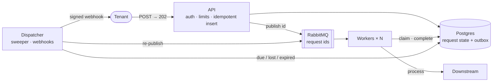
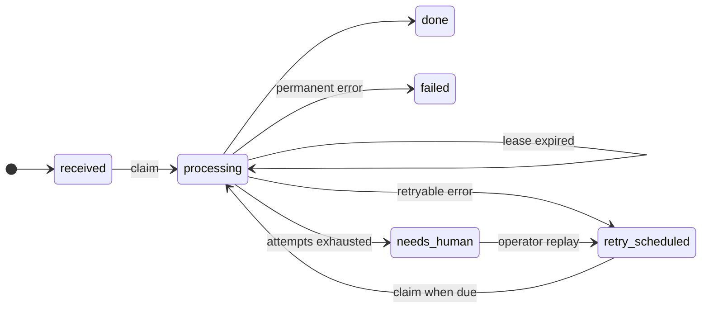

# Request pipeline

An asynchronous processing pipeline behind a public API. Tenants submit requests over HTTP and get `202 Accepted` back. The pipeline then:
- processes each request against a downstream service;
- retries failures with backoff;
- reports the final state to the tenant by polling or a signed webhook.

The pipeline keeps three guarantees:
- every accepted request reaches a final state;
- no request takes effect twice;
- no tenant can degrade service for the others.

> Built as a follow-up to a system design interview at Chekin. The target load was ~1M requests per hour from thousands of tenants. The interview covered intake; this repository covers **what happens after a worker takes a request off the queue**.

**Contents:**
[Quick start](#quick-start) ·
[How it works](#how-it-works) ·
[Guarantees](#guarantees) ·
[Failure handling](#failure-handling) ·
[API](#api) ·
[Operations](#operations) ·
[Performance](#performance) ·
[Testing](#testing) ·
[Design decisions](#design-decisions) ·
[Limitations](#limitations-and-next-steps) ·
[Development](#development)

## Quick start

Requires Docker and [uv](https://docs.astral.sh/uv/).

```bash
make up            # api :8080, workers, dispatcher, downstream mock :8081, Postgres, RabbitMQ

curl -s -X POST localhost:8080/v1/requests \
  -H 'Authorization: Bearer demo-key-a' -H 'Idempotency-Key: demo-1' \
  -H 'content-type: application/json' -d '{"type": "guest.register", "data": {"name": "Ana"}}'
# 202 {"id": "<id>", "status": "received", "status_url": "/v1/requests/<id>"}

curl -s localhost:8080/v1/requests/<id> -H 'Authorization: Bearer demo-key-a'
# {"status": "done", "result": {...}, ...}

make down          # stop and delete data
```

The demo tenants use test keys defined in [`migrations/002_demo_tenants.sql`](migrations/002_demo_tenants.sql):

| Key | Behaviour |
|---|---|
| `demo-key-a` | Receives webhooks |
| `demo-key-b` | Polls for results |
| `demo-key-noisy` | Rate-limited to 5 requests/s |

## How it works



| Component | Responsibility |
|---|---|
| **API** | Authenticates the tenant and applies per-tenant rate limits and queue-depth load shedding. Stores the request idempotently, then publishes its id |
| **Postgres** | The source of truth for every request's state. It also serves as the webhook outbox |
| **RabbitMQ** | Distributes request ids to workers. A message is only a hint that there may be work: losing or duplicating one is harmless |
| **Workers** | Stateless. Each one claims a request, calls the downstream, classifies the outcome and records it |
| **Dispatcher** | Re-publishes requests whose retry is due, whose message was lost, or whose worker died. Delivers webhooks and refreshes health gauges |

### Request lifecycle



All transitions are defined in one place: [`domain/request.py`](src/pipeline/domain/request.py).

### Processing one request

[`worker/handler.py`](src/pipeline/worker/handler.py) handles one request in these steps:

1. **Claim.** A single conditional update moves the request to `processing` under a time-limited lease. It succeeds only if the request is new, its retry is due, or its previous lease has expired. Otherwise the delivery is a duplicate and is skipped.
2. **Process.** Call the downstream under a timeout, with the request id as the idempotency key. A repeat after a crash then returns the original result instead of a second effect.
3. **Classify.**
   - Timeouts, connection errors, `429` and `5xx` are retryable.
   - Other `4xx` are permanent.
   - Unknown errors are retryable, within the attempt limit.
4. **Record.** The outcome is written only if this worker still holds the lease. The attempt number serves as a fencing token, so a stalled worker cannot overwrite a newer result. A final state arms the webhook in the same statement.
5. **Acknowledge** the message whatever happened. Postgres holds the state, and the dispatcher repairs anything a lost step leaves behind.

Retries use exponential backoff with equal jitter. Delays are spread out, but a minimum retry window is guaranteed. After `max_attempts` the request moves to `needs_human`. If a worker dies on the same request again and again, a crash-loop guard stops it from being processed a further time.

## Guarantees

| Guarantee | Mechanism | Verified by |
|---|---|---|
| Every accepted request reaches a final state | State in Postgres; the dispatcher re-publishes due, lost and abandoned work | Integration tests; failure scenarios; chaos campaign (invariant I1) |
| At most one effect per request | Conditional claim, fenced completion, downstream idempotency key | Property-based tests; chaos campaign (I2) |
| Bounded retries with a minimum window | Equal-jitter backoff, attempt limit, `needs_human` with operator replay | Unit and property tests; failure scenarios |
| Tenant isolation | Per-tenant token bucket at intake; per-tenant webhook concurrency | Unit tests; webhook isolation tests |
| Overload stays predictable | `503 + Retry-After` above a queue-depth threshold, before anything is written | Unit tests; load runs |
| Malformed input never breaks the service | Every invalid body or header gets a JSON `4xx` | Unit and integration tests |

## Failure handling

| Failure | Behaviour |
|---|---|
| Broker unavailable at intake | The request is stored and still accepted. The dispatcher publishes it once the broker is back |
| Database unavailable at intake | `503 + Retry-After`, and readiness fails. Clients retry with the same idempotency key |
| Worker crashes or freezes mid-request | The lease expires and another worker re-claims the request. A frozen worker that later resumes is fenced off |
| Duplicate or redelivered message | The claim lets only one through. A scheduled retry cannot start before it is due |
| Downstream slow, failing or down | Timeout, then backoff retries, then `needs_human` with an alert. Once the downstream is fixed, an operator replays the requests |
| Unparseable message | Moved to the dead-letter queue and counted |
| Tenant webhook endpoint down or slow | Backoff retries. That tenant's slots are occupied, so other tenants are unaffected. Results remain available via `GET` |
| Backlog grows | Load shedding at intake. Lost-message recovery pauses while the queue is busy, so recovery does not add duplicates |

Every row is exercised by a test: see [`tests/integration/test_failures.py`](tests/integration/test_failures.py) and the [chaos campaign](#testing).

## API

| Endpoint | Description |
|---|---|
| `POST /v1/requests` | Submit `{"type": str, "data": object}`. The `Idempotency-Key` header is required |
| `GET /v1/requests/{id}` | Status, attempt, result and last error. A tenant sees only its own requests |
| `GET /healthz`, `GET /readyz` | Liveness, and readiness with a per-dependency check |
| `GET /metrics` | Prometheus metrics |

| `POST` response | Meaning |
|---|---|
| `202` | Accepted. A repeat with the same key and body returns the same id, with `Idempotent-Replayed: true` |
| `400` / `422` | Missing key, invalid body, or the same key reused with a different body |
| `401` | Unknown API key |
| `413` | Body larger than 64 KB |
| `429` / `503` | Rate-limited, overloaded or temporarily unavailable. Retry after `Retry-After` |

**Webhooks.** A webhook is a `POST` of `{id, status, result, error, attempt}` with these headers:
- `X-Signature: sha256=<HMAC of the body with the tenant secret>`
- `X-Request-Id`, used to deduplicate: delivery is at least once.

## Operations

**Configuration.** All settings are environment variables prefixed `PIPELINE_`, defined in [`config.py`](src/pipeline/config.py). The main ones:

| Setting | Default | Purpose |
|---|---|---|
| `WORKER_CONCURRENCY` | 50 | Requests in flight per worker process (the RabbitMQ prefetch) |
| `PROCESSING_TIMEOUT_S` / `LEASE_S` | 10 / 30 | Downstream call timeout / claim lease. Startup fails unless the lease exceeds the worst-case attempt |
| `MAX_ATTEMPTS`, `RETRY_BASE_S`, `RETRY_MAX_S` | 5, 1, 60 | Retry budget and backoff |
| `STALE_AFTER_S` | 60 | How long before an unclaimed request counts as a lost message |
| `MAX_QUEUE_DEPTH` | 200 000 | Load-shedding threshold |
| `WEBHOOK_MAX_ATTEMPTS`, `WEBHOOK_PER_TENANT_CONCURRENCY` | 8, 4 | Webhook retry budget and isolation |

**Observability.**
- JSON logs carry the `request_id`.
- Prometheus metrics are defined in [`observability.py`](src/pipeline/observability.py). Labels are bounded, so tenant ids never become labels.
- The primary health signal is **`pipeline_oldest_unfinished_seconds`**. It rises whenever any part of the pipeline stops making progress, regardless of traffic volume.
- Alert rules are in [`docs/alerts.yml`](docs/alerts.yml).

**Runbook.**

| Situation | Action |
|---|---|
| `RequestsWaitingForHuman` fires | Fix the cause (usually the downstream), then run `docker compose exec dispatcher python -m pipeline replay [--id <id>]`. Replayed requests get a fresh retry budget |
| Backlog grows, or `IntakeShedding` fires | Add workers: `make scale N=<n>`. Throughput scales with worker processes |
| A component restarts | No action. In-flight work is re-claimed after its lease expires |

## Performance

Measured on a laptop: Docker with 4 vCPU shared by every service and the load generator. Details are in [`loadtest/results`](loadtest/results/README.md).

| Workers | Offered | Accepted | Processed | End-to-end p50 | Lost |
|---|---|---|---|---|---|
| 1 | ~300 rps | 267 rps | 121/s | 48 s | 0 |
| 4 | ~300 rps | 173 rps | 144/s | 1.9 s | 0 |

- A worker process is **CPU-bound at about 120 requests/s**. It is not I/O-bound, so the system scales by processes (containers), not threads ([ADR-0007](docs/adr/0007-one-asyncio-process-per-container.md)).
- 1M requests/hour (~280/s) needs about three worker cores. The ×5 peak needs about twelve. This is extrapolated from the measured per-core cost.

## Testing

| Layer | What it covers | Command |
|---|---|---|
| Unit | Domain rules, the worker flow, API behaviour and the dispatcher, all on in-memory fakes | `make check` (also lint and docstrings) |
| Property-based | Random interleavings of duplicates, crashes, lease expiries, frozen workers and replays. Safety and liveness are checked after every step | part of `make check` (3000 examples in CI) |
| Integration | The real SQL, broker and API against the running stack, plus six failure scenarios | `make test-integration` |
| Chaos campaign | Random faults in every component under steady load, then the invariants I1 to I6 ([`tests/invariants.py`](tests/invariants.py)) | `make chaos-campaign` |
| Load | Throughput and latency for 1 and 4 workers | `make load WORKERS=4 USERS=300` |

CI runs the unit, property and integration layers on every pull request.

The deeper layers found real defects that example tests missed. Each now has a regression test:
- under a backlog, the sweeper re-published queued requests as "lost";
- webhook delivery was capped at about 8 per second per tenant;
- random backoff could spend every retry within about two seconds;
- malformed input produced `500` errors.

## Design decisions

| Decision | Choice | ADR |
|---|---|---|
| Where state lives | The Postgres row; the message carries only the id | [0001](docs/adr/0001-postgres-is-the-source-of-truth.md) |
| Queue | RabbitMQ quorum queue with publisher confirms and a dead-letter queue | [0002](docs/adr/0002-rabbitmq-quorum-queue.md) |
| At most one effect | Lease, fencing token and downstream idempotency key | [0003](docs/adr/0003-claim-with-lease-and-fencing.md) |
| Retries and recovery | Scheduled in the database; one sweeper | [0004](docs/adr/0004-retries-in-the-database-and-a-sweeper.md) |
| Answering the client | `202`, then polling or signed webhooks from a table outbox | [0005](docs/adr/0005-async-accept-polling-and-signed-webhooks.md) |
| Intake protection | Per-process token bucket and queue-depth shedding | [0006](docs/adr/0006-intake-protection-per-replica.md) |
| Concurrency | One asyncio process per container; scale by containers | [0007](docs/adr/0007-one-asyncio-process-per-container.md) |

## Limitations and next steps

This is a prototype with its core guarantees verified, not a production deployment. In priority order, the remaining work is:

1. **Schema migrations.** The schema is applied only to an empty database. A migration tool is needed before the first change on live data.
2. **Verification at scale.**
   - Soak runs of several hours.
   - Postgres failover.
   - Several dispatcher and API replicas at once.
   - Load on real infrastructure.
3. **High availability.**
   - A managed or Patroni Postgres, with the `requests` table partitioned and a retention policy.
   - A three-node RabbitMQ cluster.
   - Autoscaling workers on queue depth and request age.
4. **Fairness.**
   - Per-tenant fair scheduling at processing time; today only intake is per-tenant.
   - A global rate limiter, because the current one counts per API process.
5. **Security and compliance.**
   - OAuth client credentials and TLS.
   - Replay-protected webhook signatures.
   - Encryption and retention for personal data.

## Development

```bash
uv sync && make check     # lint, docstrings, unit and property tests
make up && make test-integration
```

| Path | Contents |
|---|---|
| `src/pipeline/domain/` | Lifecycle rules, retry policy, errors (pure, no I/O) |
| `src/pipeline/worker/` | Request handler and queue consumer |
| `src/pipeline/api/` | Intake API, authentication, rate limiting, load shedding |
| `src/pipeline/dispatcher/` | Sweeper, webhook sender, health gauges |
| `src/pipeline/adapters/` | Postgres, RabbitMQ and HTTP implementations of the interfaces in `ports.py` |
| `src/pipeline/main.py` | Wiring of services; `python -m pipeline {worker, dispatcher, replay}` |
| `mock_downstream/` | Downstream and webhook sink with runtime fault injection |
| `tests/`, `loadtest/` | Test layers above; load and chaos tooling |
| `docs/` | Specification, decisions, task plans, alert rules |

Each change follows the same loop:
1. A [specification](docs/sdlc/spec.md) and a [roadmap](docs/sdlc/roadmap.md).
2. A written plan per task in [`docs/tasks/`](docs/tasks).
3. Tests first.
4. Review by a fresh-context verifier agent against [`REVIEW.md`](REVIEW.md).

Contributor and agent conventions are in [`AGENTS.md`](AGENTS.md).
